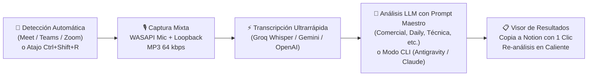

# 🎙️ Grabador de Reuniones IA (Estilo Notion & Wispr Flow)

[](https://dotnet.microsoft.com/)
[](https://microsoft.com/windows)
[](#-compilación-y-publicación)
[](LICENSE)
[](https://github.com/enrelu/grabador-reuniones/releases)

Aplicación nativa y ultraligera para Windows que reside discretamente en la **bandeja del sistema (System Tray)**. Diseñada para grabar reuniones presenciales y virtuales (Google Meet, Microsoft Teams, Zoom, Slack), mezclar en tiempo real el audio del micrófono y de los demás participantes, transcribir a alta velocidad y aplicar **Prompts Maestros especializados con Inteligencia Artificial** para extraer notas estructuradas, acuerdos, decisiones y tareas en formato Markdown listas para copiar a Notion, Obsidian o correo electrónico.

---

## ⚡ Características Principales



* **🪶 Ultraligera y Silenciosa:**
  * En reposo en la bandeja del sistema consume **0% de CPU y ~25-35 MB de RAM**.
  * Cero sobrecarga de Electron o navegadores embebidos.
* **🔔 Detección Inteligente de Reuniones:**
  * Monitoriza discretamente el inicio de videollamadas en **Google Meet (Chrome, Edge, Brave), Microsoft Teams y Zoom**.
  * Muestra una notificación emergente sobre la barra de tareas ofreciéndote comenzar a grabar con la plantilla adecuada en un solo clic.
* **🎧 Mezcla Mixta Inteligente en Directo:**
  * Captura tu voz (micrófono) y el audio del sistema (interlocutores) en hilos sincronizados mediante WASAPI Loopback a 48 kHz.
  * Codifica directamente a **MP3 voz a 64 kbps**: una reunión de 1 hora ocupa **menos de 28 MB**, facilitando subidas instantáneas a los modelos de IA.
* **⚡ Transcripción de Máxima Velocidad:**
  * **Groq Cloud (Whisper Large v3 Turbo):** Transcribe 30 minutos de conversación en **apenas 4-5 segundos**.
  * **Google Gemini 2.0 / 1.5 Flash:** Admite audio directo con marcas de tiempo.
  * **OpenAI Whisper-1** o **Servidores Locales** compatibles (LocalAI, Whisper.cpp, Ollama).
* **💻 Soporte para Herramientas CLI (Sin Claves de API):**
  * Soporte nativo para **Google Antigravity CLI (`agy`)** y **Claude Code CLI (`claude`)**.
  * Permite ejecutar la transcripción y el razonamiento LLM a través de tus herramientas de línea de comandos habituales **sin necesidad de introducir claves API ni pagar saldos de desarrollador adicionales**.
* **🎯 7 Prompts Maestros por Tipología de Reunión:**
  * 💼 **Comercial / Clientes:** Puntos de dolor, presupuesto, objeciones y compromisos mutuos.
  * 🚀 **Seguimiento / Daily / Sprint:** Qué se completó, qué está en curso, bloqueos y tabla de responsables.
  * 🛠️ **Técnica / Arquitectura:** Decisiones adoptadas, alternativas descartadas, riesgos y deuda técnica.
  * 👥 **1-on-1 / Personas:** Bienestar laboral, feedback bidireccional y plan de apoyo personal.
  * 🧠 **Brainstorming / Ideas:** Resumen de ideas generadas, viabilidad preliminar y próximos experimentos.
  * 📋 **Resumen Ejecutivo General:** Síntesis concisa en viñetas, decisiones firmes y tabla de tareas.
  * ✏️ **Personalizado:** Editor visual integrado para crear tus propias instrucciones y formatos.
* **📋 Visor de Resultados y Copia a Notion:**
  * Previsualiza el Markdown estructurado y la transcripción íntegra.
  * **Copia para Notion con 1 clic:** Formateado con cajas de verificación `[ ]`, encabezados jerárquicos y tablas limpias.
  * **Re-análisis en caliente:** ¿Grabaste una reunión como *Daily* y resultó ser *Comercial*? Cambia de plantilla y re-ejecuta el LLM al instante **sin volver a transcribir el audio**.
* **🔒 Seguridad y Privacidad Absoluta:**
  * Los audios se guardan de forma local en tu equipo.
  * Las claves API se almacenan cifradas en disco utilizando **Windows DPAPI** (`DataProtectionScope.CurrentUser`); nunca viajan ni se guardan en texto claro.

---

## 💰 ¿Se puede usar 100% Gratis?

**Totalmente.** La aplicación está diseñada para operar con cuotas gratuitas permanentes:

| Servicio | Proveedor Recomendado | Límites Gratuitos |
| :--- | :--- | :--- |
| **Transcripción** | **Groq Cloud (Whisper Large v3 Turbo)** | 25 req/min, 7.200 seg de audio/hora gratis. Transcripción en ~4 seg. |
| **Análisis IA** | **Google Gemini Flash (AI Studio)** | Hasta 15 req/min y 1.500 solicitudes/día gratuitas en Google AI Studio. |
| **Vía CLI** | **Google Antigravity (`agy`) / Claude CLI (`claude`)** | Ilimitado dentro de tu sesión activa de terminal sin saldo API. |

*(Nota: si optas por la API de pago de OpenAI con Whisper + GPT-4o-mini, el coste medio por cada 30 minutos de reunión es de apenas 0,18 €).*

---

## 📂 Archivos Generados por Sesión

Por defecto en `%USERPROFILE%\Documentos\GrabadorReunionesIA\Grabaciones\`:

| Extensión | Descripción |
| :--- | :--- |
| `*.mp3` | Grabación estéreo mezclada a 64 kbps (micrófono + sistema). |
| `*.transcripcion.txt` | Texto literal transcrito por Whisper / Gemini. |
| `*.resumen.md` | Minuta estructurada en Markdown con el Prompt Maestro seleccionado. |
| `*.json` | Metadatos técnicos (duración, dispositivos utilizados, fecha/hora). |

---

## 🚀 Descarga y Ejecución

No requiere instalador ni privilegios de administrador:

1. Ve a la sección de [Releases](https://github.com/enrelu/grabador-reuniones/releases).
2. Descarga `GrabadorReuniones.exe`.
3. Ejecútalo. Aparecerá el icono en el área de notificación (junto al reloj).

---

## ⌨️ Atajos y Uso

* **Iniciar / Detener Grabación:** Pulsa `Ctrl+Shift+R` (o haz clic en el icono de la bandeja).
* **Detección Automática:** Cuando comience una llamada en Google Meet, Teams o Zoom, aparecerá una ventana emergente en la esquina inferior derecha:
  * Elige la plantilla de reunión deseada en el desplegable.
  * Pulsa **Grabar reunión** para iniciar la captura de inmediato.
* **Menú Contextual:** Haz clic derecho en el icono de la bandeja para pausar, cambiar ajustes o abrir la carpeta de grabaciones.

---

## 🛠️ Compilación para Desarrolladores

### Requisitos
* [Windows 10 / 11](https://www.microsoft.com/windows)
* [.NET 8.0 SDK](https://dotnet.microsoft.com/download/dotnet/8.0)

### Comandos de Compilación

```powershell
# Clonar el repositorio
git clone https://github.com/enrelu/grabador-reuniones.git
cd grabador-reuniones

# Ejecutar la suite de pruebas unitarias
dotnet test GrabadorReuniones.sln -c Release --nologo

# Publicar el ejecutable único portable para Windows x64
.\scripts\publish.ps1
```

El binario autocontenido y optimizado se genera en:
`dist\win-x64\GrabadorReuniones.exe`

---

## 🛡️ Seguridad y Privacidad

1. **Cero Telemetría:** La aplicación no recopila diagnósticos ni envía información a servidores de terceros que no sean los proveedores de IA configurados explícitamente por el usuario.
2. **Cifrado Local:** Los tokens de API se protegen mediante la API nativa de protección de datos de Windows (`DPAPI`), vinculada a tu cuenta de usuario de Windows.
3. **Control Local del Audio:** El audio nunca sale de tu equipo salvo el payload enviado al endpoint de transcripción configurado.

---

## 📄 Licencia

Este proyecto está bajo la Licencia **MIT**. Consulta el archivo [LICENSE](LICENSE) para más detalles.
